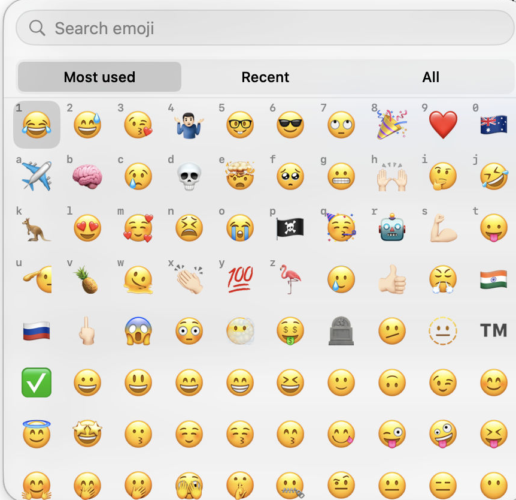

# Spritz

A macOS emoji picker with **one-key selection** and persistent mnemonic letters. This is an independent fork of [Mojito by Wells Riley](https://github.com/wr/mojito), based on v1.10.1.



## What changed

- Open the picker, then press a visible number or letter to insert its emoji immediately.
- Number keys 1–9 and 0 sit on the first row. Letters a–z sit in alphabetical slots underneath. A fresh install fills empty letters with memorable matches, such as **h** for ❤️, when one is free.
- Most used, Recent and All views retain your full history. New installations open All until there is usage history.
- Context suggestions use local keyword matching. They never send surrounding text to a service.
- The picker opens near the text caret when the app exposes it. Otherwise placement uses an approximate window-based fallback.
- Click Search to type a query; arrows and Return still navigate and insert. Escape closes the picker.

Drag an emoji onto a number or letter to take that key. Drag it onto empty space to clear the key. A cleared slot stays empty, and the other keys do not move. The same letter shows its emoji on Most used, Recent and All. Emoji without a key fill the rest of the grid. No multi-letter sequences are required.

## Preview release

This is a **source preview**, not a notarized app distribution. There is no downloadable installer for this fork yet. The upstream website and Homebrew cask install the original Mojito, without these changes.

Requires macOS 14 or later to run, and Xcode 26 or later to build the Icon Composer assets. Build and test with:

```sh
git clone https://github.com/todd866/spritz.git
cd spritz
scripts/build-fork.sh test
scripts/build-fork.sh build
```

The app is built at `~/Library/Caches/MojitoFork/Derived/Build/Products/Debug/Spritz Dev.app`. The script uses ad-hoc signing and does not install or launch it. For repeated local development, supply a persistent signing identity via an `xcodebuild` override so macOS permissions can survive rebuilds.

The fork uses `io.github.todd866.Spritz` / `.dev` bundle identities. It needs its own Accessibility and Input Monitoring permissions. Run only one emoji picker at a time to avoid competing shortcuts. No private signing credentials or API keys are included.

## Fn / Globe setup

Set an Emoji Browser shortcut in General settings. Mojito also provides a “Press Globe key to open Mojito” option. If a keyboard or macOS configuration does not reliably deliver that event, map a **tap** of Fn to your browser shortcut with Karabiner-Elements, keeping a held Fn unchanged. This fork does not modify Karabiner or system settings automatically.

A tested setup uses Control–Option–Space as the browser shortcut and maps an Fn tap to it. Test insertion in a normal text field after granting permissions.

## Privacy and updates

Emoji counts, recent choices and key assignments stay in local preferences. Surrounding-text suggestions read a short preceding range from supported non-password fields; the transient context expires and is not written to disk or sent over the network. Some apps do not expose a caret or text context, so placement and suggestions vary by app.

The fork disables telemetry collection/upload and automatic updates to the upstream app. “Check now” opens this fork's GitHub releases. Optional GIF search requires your own KLIPY API key and sends GIF search terms to KLIPY; emoji selection needs no network connection.

Your Apple emoji history is not imported automatically. No developer's personal emoji history or preference exports are included.

## Contributing

Report issues and propose improvements in [this fork](https://github.com/todd866/spritz/issues). Useful next steps include better caret placement across apps and a signed, notarized download. Keep changes focused and include tests for selection, persistence and cleared slots.

## Credits and licence

Original Mojito © 2026 Wells Riley. Fork modifications © 2026 Ian Todd. Modified October 2026. Licensed under [GNU AGPL v3](LICENSE); the original licence and attribution are retained.

Mojito builds on emojibase, [Emoogle](https://github.com/xitanggg/emoogle-emoji-search-engine), Sparkle, KeyboardShortcuts, KLIPY, and a Swift port of fzy. To support the original author, see [Wells Workshop](https://buymeacoffee.com/wellsworkshop).
