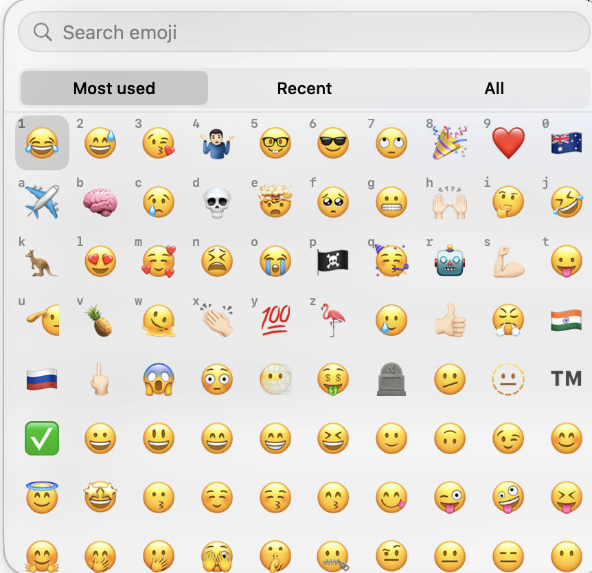

# Spritz

A macOS emoji picker with **one-key selection**, persistent mnemonic letters, and **Fn dictation with text alternatives**. This is an independent fork of [Mojito by Wells Riley](https://github.com/wr/mojito), based on v1.10.1.



## What changed

- Open the picker, then press a visible number or letter to insert its emoji immediately.
- Number keys 1–9 and 0 sit on the first row. Letters a–z sit in alphabetical slots underneath. A fresh install fills empty letters with memorable matches, such as **h** for ❤️, when one is free.
- Most used, Recent and All views retain your full history. New installations open All until there is usage history.
- Context suggestions use local keyword matching. They never send surrounding text to a service.
- The picker opens near the text caret when the app exposes it. Otherwise placement uses an approximate window-based fallback.
- Click Search to type a query; arrows and Return still navigate and insert. Escape closes the picker.

Drag an emoji onto a number or letter to take that key. Drag it onto empty space to clear the key. A cleared slot stays empty, and the other keys do not move. The same letter shows its emoji on Most used, Recent and All. Emoji without a key fill the rest of the grid. No multi-letter sequences are required.

## Preview release

This is a **source preview**, not a notarized app distribution. There is no downloadable installer for this fork yet. The upstream website and Homebrew cask install the original Mojito, without these changes.

Requires macOS 14 or later to run, and Xcode 26 or later to build the Icon Composer assets. Build and test with:

```sh
git clone https://github.com/todd866/spritz.git
cd spritz
scripts/build-fork.sh test
scripts/build-fork.sh build
```

The app is built at `~/Library/Caches/MojitoFork/Derived/Build/Products/Debug/Spritz Dev.app`. The script uses ad-hoc signing and does not install or launch it. For repeated local development, supply a persistent signing identity via an `xcodebuild` override so macOS permissions can survive rebuilds.

The fork uses `io.github.todd866.Spritz` / `.dev` bundle identities. It needs its own Accessibility and Input Monitoring permissions. Run only one emoji picker at a time to avoid competing shortcuts. No private signing credentials or API keys are included.

## Fn / Globe and dictation (0.4.1)

Enable the Globe-key browser option in General settings and grant Accessibility and Input Monitoring access. For Apple speech, also grant Microphone and Speech Recognition access when prompted. Remove conflicting Fn remaps: a legacy Karabiner rule that changes held Fn can prevent dictation. Spritz does not change system shortcuts or Karabiner settings automatically.

- **Tap Fn:** open the combined emoji picker and text-alternatives panel.
- **Hold Fn, speak, release:** dictate using the selected speech input.
- **Tab / Shift-Tab with the picker open:** preview the available text alternatives without changing the draft.
- **Enter after previewing text:** apply that alternative. **Use** does the same; if safe replacement cannot be verified, **Copy** is offered instead.
- **Escape:** dismiss the picker without applying the preview. Typing or navigating emojis returns Enter to emoji selection.

General settings offers three speech-input modes:

| Mode | Audio recognition and insertion |
| --- | --- |
| Apple | On-device Apple recognition; Spritz inserts the transcript. |
| ChatGPT Dictate | The installed ChatGPT/Codex app owns audio recognition and insertion. Configure its native hold-to-dictate shortcut to Fn first. |
| Apple + ChatGPT | Capture an Apple alternative alongside native Dictate; only native Dictate inserts the initial text. |

Native Dictate is an integration with the installed app's shortcut, not a bundled transcription API. It requires that app's dictation feature and your account access. Spritz does not extract subscription credentials or configure new API billing.

Optional **Speech alternatives** uses the installed, signed-in Codex or Claude CLI, or can be set to Off. After a captured native insertion, it automatically reviews the whole dictated passage and compares the Apple transcript when available. The picker offers **Apple**, **GPT**, and **Reviewed** as results become available. Reviewed analyses text; it does not listen to the audio again. Apple-only mode offers Apple, Corrected and Clearer. New results never replace your draft automatically.

**Current limitations:** this is experimental. Native insertion capture and the Reviewed option are not yet reliable on every attempt; the panel can remain on “Waiting for dictation.” A deeper review has taken roughly 8–12 seconds in local tests. Only captured sources appear, and dictation accuracy varies, particularly with specialist terminology and background noise. Medical corrections can be wrong: inspect the actual wording and uncertainty notes before applying it. The explicit **Analyse text** button reviews the entire current draft when automatic capture misses it.

Replacement requires the same non-password editable field, unchanged field contents and unchanged caret. Otherwise use Copy. Text alternatives expire after two minutes and are cleared on app/field changes and sleep/lock. Full passages scroll inside the panel.

## Privacy and updates

Emoji counts, recent choices and key assignments stay in local preferences. Surrounding-text suggestions read a short preceding range from supported non-password fields; the transient context expires and is not written to disk or sent over the network. Some apps do not expose a caret or text context, so placement and suggestions vary by app.

The fork disables upstream telemetry upload and automatic updates to the upstream app. Spritz now records **local-only operational telemetry**: aggregate counts and timing for picker, speech and review actions, retained for 90 UTC days at `~/Library/Application Support/Spritz/telemetry.json`. It contains no transcripts, audio, app names, field contents, credentials or raw errors and is not uploaded. Inspect it by running the app executable with `--telemetry`.

Apple recognition runs on-device. Native Dictate handles audio under its own service settings and policies. Optional CLI review sends the captured transcript and available Apple alternative to the selected provider; **Analyse text** explicitly sends the whole current draft. Spritz keeps text and replacement snapshots in memory only, uses ephemeral CLI sessions, and does not write transcript files. Provider data policies still apply.

 “Check now” opens this fork's GitHub releases. Optional GIF search requires your own KLIPY API key and sends GIF search terms to KLIPY; emoji selection needs no network connection.

Your Apple emoji history is not imported automatically. No developer's personal emoji history or preference exports are included.

## Contributing

Report issues and propose improvements in [this fork](https://github.com/todd866/spritz/issues). Useful next steps include better caret placement across apps and a signed, notarized download. Keep changes focused and include tests for selection, persistence and cleared slots.

## Credits and licence

Original Mojito © 2026 Wells Riley. Fork modifications © 2026 Ian Todd. Modified November 2026. Licensed under [GNU AGPL v3](LICENSE); the original licence and attribution are retained.

Mojito builds on emojibase, [Emoogle](https://github.com/xitanggg/emoogle-emoji-search-engine), Sparkle, KeyboardShortcuts, KLIPY, and a Swift port of fzy. To support the original author, see [Wells Workshop](https://buymeacoffee.com/wellsworkshop).
