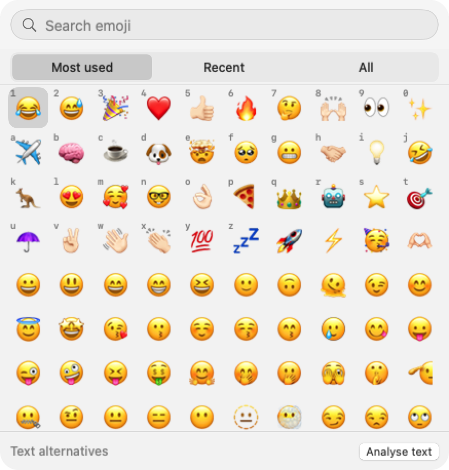
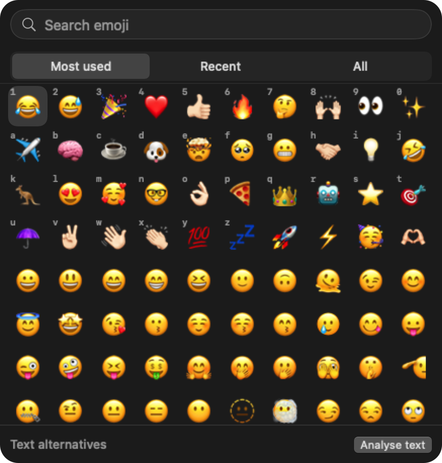
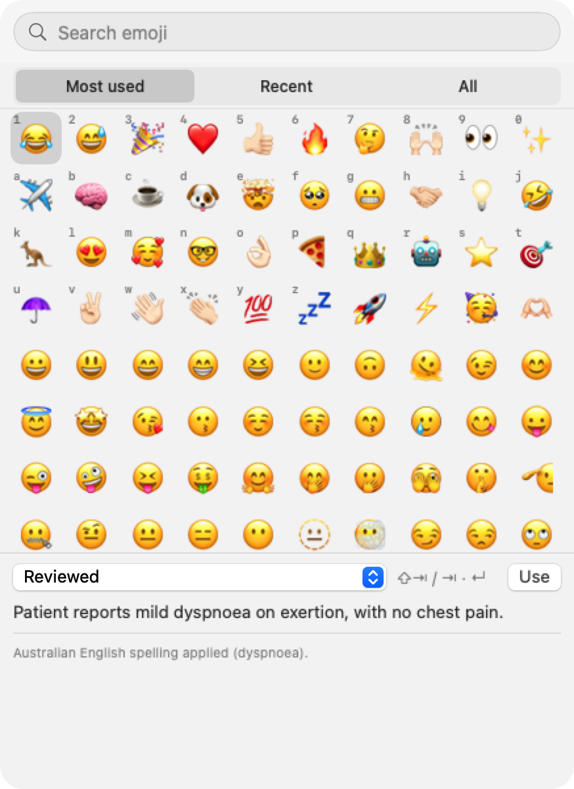
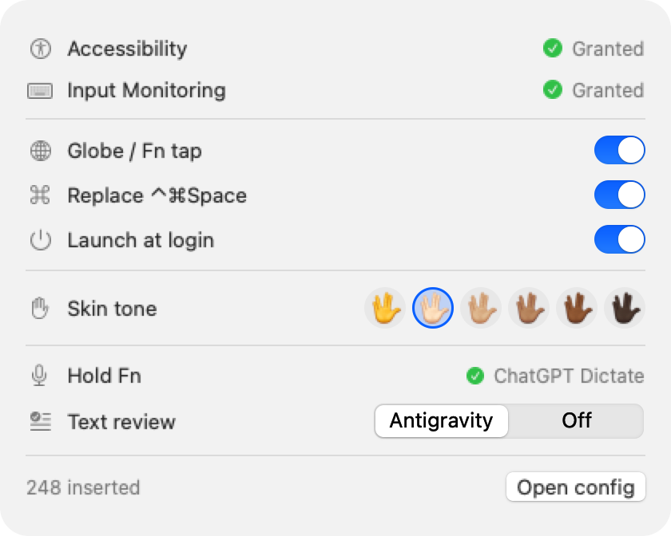

# Spritz

Clean-room native Rust + SwiftUI/AppKit keyboard-first emoji picker for macOS. ~3.2 MB release bundle, zero non-system dylibs, MIT licensed.

<table>
  <tr>
    <th>Light</th>
    <th>Dark</th>
  </tr>
  <tr>
    <td></td>
    <td></td>
  </tr>
</table>

## Features

- **One-key muscle memory (`1`–`0` & `a`–`z`):** Tap `Fn`/Globe (or `⌃⌘Space`) to open Spritz anchored to your caret, then press a single key to insert immediately at your cursor. Drag and drop any emoji onto a `1`–`0` or `a`–`z` slot to assign or swap; drag an assigned slot outside the grid to unbind it.
- **Direct Unicode insertion (never clobbers your clipboard):** Pastes via `CGEventKeyboardSetUnicodeString` with UTF-16-safe chunking (at most 20 UTF-16 code units per event). Automatically detects macOS Secure Event Input (`IsSecureEventInputEnabled` / IOKit holder PID) and switches cleanly to a local key-monitor and copy fallback when protected fields block synthetic events.
- **Fuzzy search & local context suggestions:** `fzy`-ranked search across 1,906 Emojibase v16 emojis with skin-tone support, plus local surrounding-text suggestions via Accessibility (including live async AX refresh for Chromium/Electron `contenteditable` fields).
- **Hold-`Fn` dictation pass-through & optional text-review strip:** A quick `Fn` tap invokes Spritz; holding `Fn` passes cleanly through to system or ChatGPT dictation without interference. Settled dictation diffs are captured locally and can surface side-by-side alternatives in the bottom strip:

<picture>
  <source media="(prefers-color-scheme: dark)" srcset="docs/screenshots/picker-review-dark.png">
  <source media="(prefers-color-scheme: light)" srcset="docs/screenshots/picker-review-light.png">
  
</picture>

- **Compact single-screen settings, Touch Bar bridge & local-only telemetry:** Manage permissions, Globe/`⌃⌘Space` replacement, `SMAppService` Launch at Login, skin tone, and text review from one compact popover. Schema-v1 Touch Bar IPC (`--bridge-status`, `--show-picker`, `--enable-login`) and 90-day local operational telemetry (`--telemetry`) stay strictly on disk with zero network calls or third-party analytics.

<picture>
  <source media="(prefers-color-scheme: dark)" srcset="docs/screenshots/settings-dark.png">
  <source media="(prefers-color-scheme: light)" srcset="docs/screenshots/settings-light.png">
  
</picture>

## Shortcuts

| Shortcut | Action |
| --- | --- |
| `Fn` / Globe tap or `⌃⌘Space` | Toggle Spritz at the active caret (mouse cursor fallback) |
| `1`–`0`, `a`–`z` | Insert that slot's bound emoji and close (when not typing in Search) |
| Click **Search emoji** | Enter fuzzy search mode (`Backspace` edits query; disables `1`–`0`/`a`–`z` triggers) |
| `↑` `↓` `←` `→` | Navigate slots or search grid |
| `Return` / `Tab` | Insert selected emoji and close |
| `Shift+Return` / `Shift+Click` | Insert selected emoji and keep Spritz open |
| `Esc` | Dismiss picker |
| `Tab` / `Shift+Tab` (strip active) · `Fn+Tab` | Cycle dictation alternatives; press `Return` or **Use** to apply |
| Drag & drop | Drop an emoji onto a `1`–`0` or `a`–`z` slot to assign/swap; drag out to unbind |

## Build & Install

### Requirements

- macOS 14 or later (Sonoma+; renders native `NSGlassEffectView` Liquid Glass on macOS 26+)
- Rust toolchain (`cargo`, stable)
- Xcode / Swift 6 toolchain

### Build & Test

```sh
cargo test --workspace
./scripts/build.sh --release
```

This builds `libspritz_macos.a` in Rust, links the 6-file SwiftUI/AppKit shell against system frameworks only, and outputs `target/bundle-release/Spritz.app`. Pass `--debug` instead of `--release` for debug builds.

### Install Locally

```sh
./scripts/install-local.sh
```

`install-local.sh` builds the release bundle, signs it with `SPRITZ_SIGN_IDENTITY` (or auto-detects a `Developer ID Application` certificate in your keychain, falling back to ad-hoc `-` signing), backs up any previous `/Applications/Spritz.app` to `~/.local/state/spritz/previous-app/`, installs into `/Applications/Spritz.app`, launches it cleanly in the background, and verifies the live `CGEventTap`.

Set a custom signing identity when needed:

```sh
SPRITZ_SIGN_IDENTITY="Developer ID Application: Your Name (TEAMID)" ./scripts/install-local.sh
```

### Required Permissions

Grant both permissions in **System Settings → Privacy & Security** so Spritz can intercept `Fn` taps, detect your caret position, and insert text directly:

- **Accessibility** — caret bounds lookup, surrounding context, synthetic Unicode keystrokes
- **Input Monitoring** — low-latency `CGEventTap` for `Fn` tap vs hold detection and instant slot keys

## Configuration & CLI

User configuration and state live in standard XDG-style paths:

- Config: `~/.config/spritz/config.toml` (skin tone, `Fn` tap, `⌃⌘Space` replacement, Launch at Login, excluded bundle IDs, text review provider)
- State: `~/.local/state/spritz/state.json` (pinned `1`–`0` slots, `a`–`z` letter bindings, recents, usage counts)
- Telemetry: 90-day local-only summary stored in `~/Library/Application Support/Spritz/telemetry.json`

CLI flags supported by `/Applications/Spritz.app/Contents/MacOS/Spritz`:

- `--telemetry` — print the 90-day local operational telemetry report
- `--bridge-status` — print Touch Bar bridge schema v1 JSON state
- `--show-picker` / `--enable-login` — dispatch Touch Bar bridge commands (`--request-id`, `--expected-pid`, `--focus-generation`, `--instance-id`)
- `--render-preview <dir>` — render headless light/dark UI PNGs without taking focus

If you have existing `UserDefaults` preferences in `~/Library/Preferences/io.github.todd866.Spritz.plist`, migrate them once into `config.toml` and `state.json`:

```sh
python3 scripts/migrate_prefs.py --dry-run
python3 scripts/migrate_prefs.py
```

## Architecture & Roadmap

| Component | Responsibility |
| --- | --- |
| [`crates/spritz-core`](crates/spritz-core) | Pure Rust library with zero OS/AppKit dependencies: Emojibase catalog, `fzy` fuzzy search, `1`–`0` & `a`–`z` slot model, context matcher, `FnGesture` state machine, UTF-16 chunker, `VoiceBackend` trait, Touch Bar policy/state, local telemetry, config/state persistence |
| [`crates/spritz-macos`](crates/spritz-macos) | macOS platform I/O staticlib exposing C-ABI (`spritz_ffi.h`): `CGEventTap`, `AXObserver` + async AX cache, caret locator, chunked `CGEvent` Unicode inserter, Secure Input detector, dictation diff capture, Touch Bar state I/O |
| [`macos`](macos) | Thin SwiftUI + AppKit shell (`NonActivatingPanel`, Liquid Glass chrome, menu bar item, compact settings, Touch Bar listener, `SMAppService`) |

See [`docs/ARCHITECTURE.md`](docs/ARCHITECTURE.md) for module details and how the OS-agnostic `spritz-core` crate and shadow-first `VoiceBackend` trait extend cleanly to a future iOS keyboard target (`spritz-ios`).

## License & Third-Party Notices

- Code: [MIT License](LICENSE)
- Bundled emoji catalog & Rust crate attributions: [`THIRD_PARTY_LICENSES.md`](THIRD_PARTY_LICENSES.md) (powered by MIT-licensed `emojibase-data` v16)
